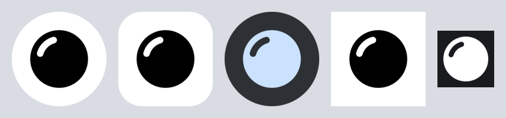

# Design

Orb's look follows GrapheneOS's own apps (Camera, Auditor, PDF Viewer, App Store, Info), so
it sits naturally on a GrapheneOS phone. It borrows their style, not their identity: no
GrapheneOS logo, hexagon or wordmark, and Orb is not affiliated with GrapheneOS.

## Launcher icon

- One solid black glyph (`#000000`) on white (`#FFFFFF`), like every GrapheneOS app icon.
- Detail is cut out of the shape (even-odd fill), not drawn on top, so the same drawable
  works as the monochrome layer for Android's themed icons.
- Rounded, Material-style geometry; nothing else on the icon (no gradients, shadows or
  colour).
- The glyph: a sphere with its highlight cut out. "Orb", read at launcher size.

`make_icon.py` generates every icon asset from one geometry: the launcher foreground and
background, the status-bar icon and the 512x512 store icon (plus `orb-icon.svg`). Edit the
script, not the generated files, and run `python3 design/make_icon.py`.
`icon_candidates.py` and `render.sh` produced the three directions considered
(`candidates.png`: orb, orbit, watch); the orb was chosen.

## Colour, type and theme (reference)

GrapheneOS publishes a short branding note
([GrapheneOS/branding-extra](https://github.com/GrapheneOS/branding-extra)):

- Generally based on Material Design 3.
- Source colour `#0053a3`, with a Material 3 theme generated from it.
- Roboto where possible, Noto as fallback; Bold preferred over Regular for headings.

The app's in-app theme still uses Core's colours. Moving it to Material 3 roles (and
dynamic colour where the system offers it) is the next design step.

## Tools

`tools/vd2svg.py` converts an Android adaptive icon (VectorDrawable foreground plus a
background colour) to SVG for previews.
